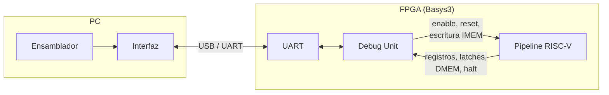

# Trabajo final: pipeline RISC-V con Debug Unit

Arquitectura de Computadoras, FCEFyN, UNC.

Integrantes: De la Mata, Nicolás; Quispe, Mateo.

Procesador RISC-V (subconjunto de RV32I) segmentado en 5 etapas sobre una Digilent Basys3 (Artix-7 `xc7a35tcpg236-1`), con una Debug Unit que permite cargar programas, ejecutarlos en modo continuo o paso a paso y leer todo el estado interno desde una PC por UART, sin resintetizar.

## Estructura

| Carpeta | Contenido |
|---|---|
| [`rtl/`](rtl/) | Verilog sintetizable: procesador, Debug Unit, UART, tope |
| [`tb/`](tb/) | Test benches |
| [`sw/`](sw/) | Ensamblador, modelo de referencia, interfaz y programas de prueba |
| [`constraints/`](constraints/) | Restricciones de la Basys3 |
| [`scripts/`](scripts/) | Scripts de Vivado y de simulación |
| [`docs/`](docs/) | Diseño y decisiones |
| [`tps_anteriores/`](tps_anteriores/) | TP1 (ALU) y TP2 (UART) |

## Documentación de diseño

| Documento | Qué tiene |
|---|---|
| [Arquitectura](docs/arquitectura.md) | Diagrama de bloques y jerarquía de módulos |
| [Datapath](docs/datapath.md) | Las 5 etapas, unidades de control, forwarding y riesgos |
| [Decisiones](docs/decisiones.md) | Cada decisión de diseño con su justificación |
| [Latches](docs/latches.md) | Campos y anchos de IF/ID, ID/EX, EX/MEM y MEM/WB |
| [Protocolo](docs/protocolo.md) | Comandos y tramas entre la PC y la Debug Unit |
| [Verificación](docs/verificacion.md) | Estrategia de test benches y modelo de referencia |
| [Convenciones](docs/convenciones.md) | Nombres, estructura y flujo de git |

## Plan de trabajo

El avance se sigue con los milestones de GitHub:

| Milestone | Contenido |
|---|---|
| M0 | Diseño y decisiones de arquitectura |
| M1 | Módulos base aislados (banco de registros, ALU, inmediatos, control, memoria de datos) |
| M2 | Pipeline sin manejo de riesgos |
| M3 | Forwarding, load-use y riesgos de control |
| M4 | Ensamblador y modelo de referencia |
| M5 | Debug Unit |
| M6 | Interfaz en la PC |
| M7 | Integración en la placa y timing |
| M8 | Informe |

## Herramientas

Vivado 2025.2, Python 3. El proyecto de Vivado no se versiona: se crea con `source scripts/crear_proyecto.tcl` (ver [convenciones](docs/convenciones.md#estructura-del-repositorio)).
