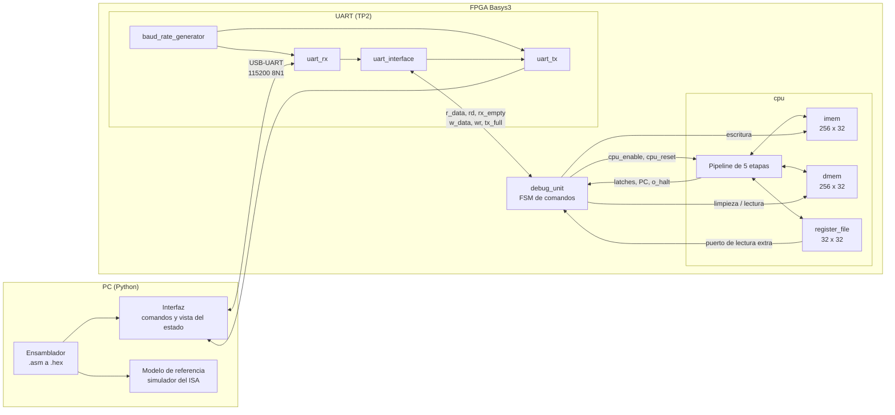

# Arquitectura del sistema

Issue: #10

Vista general de todo el sistema: qué bloques hay, cómo se conectan y qué módulos de Verilog los implementan. El detalle del procesador está en [datapath.md](datapath.md).

## Diagrama de bloques



## Interfaz entre la Debug Unit y el procesador

Es la frontera que permite desarrollar y probar el procesador sin la UART (M1 a M3) y la Debug Unit con un procesador simple (M5).

| Señal | Dirección | Ancho | Uso |
|---|---|---|---|
| `i_enable` | DU → CPU | 1 | Habilita todos los elementos de estado; adentro se combina con `!o_halt` ([D7](decisiones.md#d7-clock-enable-global)) |
| `i_cpu_reset` | DU → CPU | 1 | Reset del procesador ([D8](decisiones.md#d8-reset-y-escritura-de-la-memoria-de-programa)) |
| `i_imem_we`, `i_imem_waddr`, `i_imem_wdata` | DU → CPU | 1, 8, 32 | Escritura de la memoria de programa |
| `i_dbg_dmem_we`, `i_dbg_dmem_addr`, `i_dbg_dmem_wdata` | DU → CPU | 1, 8, 32 | Limpieza de la DMEM (solo con `i_enable = 0`) |
| `o_dbg_dmem_rdata` | CPU → DU | 32 | Lectura de la DMEM para el volcado |
| `i_dbg_reg_addr`, `o_dbg_reg_data` | DU ↔ CPU | 5, 32 | Lectura del banco de registros |
| `o_pc` | CPU → DU | 32 | PC actual |
| `o_ifid`, `o_idex`, `o_exmem`, `o_memwb` | CPU → DU | 97, 194, 112, 107 | Vectores de [latches.md](latches.md) |
| `o_halt`, `o_halt_illegal` | CPU → DU | 1, 1 | Fin del programa y su causa |
| `o_dmem_write`, `o_dmem_waddr` | CPU → DU | 1, 8 | Escrituras de los stores, para calcular la memoria usada |

## Jerarquía de módulos

```
top                          rtl/top/top.v        Pines de la placa
├── clk_wiz (M7)             IP de Vivado         Frecuencia de trabajo
├── baud_rate_generator      rtl/uart/
├── uart_rx                  rtl/uart/
├── uart_tx                  rtl/uart/
├── uart_interface           rtl/uart/            Buffer + flag del TP2
├── debug_unit               rtl/debug/
└── cpu                      rtl/core/cpu.v
    ├── imem                 rtl/core/
    ├── decoder              rtl/core/
    ├── alu_control          rtl/core/
    ├── imm_gen              rtl/core/
    ├── register_file        rtl/core/
    ├── hazard_unit          rtl/core/
    ├── forwarding_unit      rtl/core/
    ├── alu                  rtl/core/            Extendida desde el TP1
    ├── branch_unit          rtl/core/
    ├── dmem                 rtl/core/
    └── load_store_unit      rtl/core/
```

Los nombres de los módulos de la UART se mantienen como en el TP2 para reutilizarlos sin cambios (el archivo `interface.v` del TP2 pasa a llamarse `uart_interface.v`, como su módulo).

## Puertos del tope

| Puerto | Pin | Elemento |
|---|---|---|
| `i_clk` | W5 | Oscilador de 100 MHz |
| `i_reset` | T18 | BTNU |
| `i_rx` | B18 | USB-UART, PC → FPGA |
| `o_tx` | A18 | USB-UART, FPGA → PC |
| `o_leds[15:0]` (opcional) | LD0 a LD15 | Estado de la Debug Unit y bits bajos del PC, útil para depurar en la placa |

## Programa compartido entre herramientas

El ensamblador genera un único archivo por programa que usan todas las demás herramientas:

| Archivo | Formato | Lo usa |
|---|---|---|
| `programa.hex` | Una palabra de 32 bits por línea, 8 dígitos hexadecimales, sin `0x`, la dirección 0 primero | `$readmemh` en los test benches, el modelo de referencia y la interfaz para el comando Cargar |
| `programa.lst` | Listado: dirección, código máquina y línea de ensamblador | Lectura humana y la interfaz (para mostrar qué instrucción hay en cada etapa) |

Ejemplo de `.hex`:

```
00500093
00100073
```
