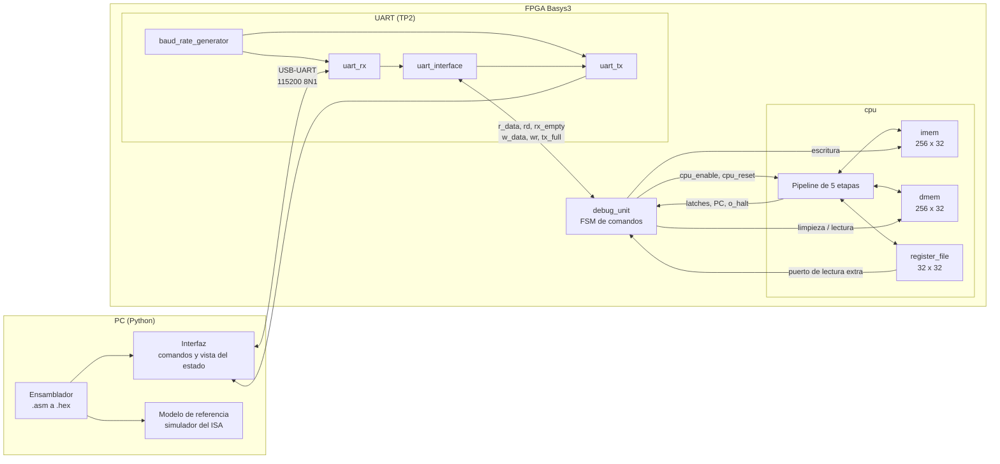
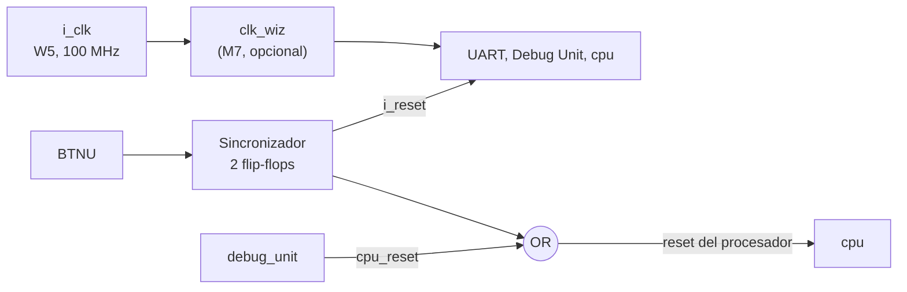

# Arquitectura del sistema

Issue: #10

Vista general de todo el sistema: qué bloques hay, cómo se conectan y qué módulos de Verilog los implementan. El detalle del procesador está en [datapath.md](datapath.md).

## Diagrama de bloques



## Interfaz entre la Debug Unit y el procesador

Es la frontera que permite desarrollar y probar el procesador sin la UART (M1 a M3) y la Debug Unit con un procesador simple (M5).

| Señal | Dirección | Ancho | Uso |
|---|---|---|---|
| `i_enable` | DU → CPU | 1 | Habilita todos los elementos de estado; adentro se combina con `!o_halt` ([D7](decisiones.md#d7-clock-enable-global)) |
| `i_cpu_reset` | DU → CPU | 1 | Reset del procesador ([D8](decisiones.md#d8-reset-y-escritura-de-la-memoria-de-programa)) |
| `i_imem_we`, `i_imem_waddr`, `i_imem_wdata` | DU → CPU | 1, 8, 32 | Escritura de la memoria de programa |
| `i_dbg_dmem_we`, `i_dbg_dmem_addr`, `i_dbg_dmem_wdata` | DU → CPU | 1, 8, 32 | Limpieza de la DMEM (solo con `i_enable = 0`) |
| `o_dbg_dmem_rdata` | CPU → DU | 32 | Lectura de la DMEM para el volcado |
| `i_dbg_reg_addr`, `o_dbg_reg_data` | DU ↔ CPU | 5, 32 | Lectura del banco de registros |
| `o_pc` | CPU → DU | 32 | PC actual |
| `o_ifid`, `o_idex`, `o_exmem`, `o_memwb` | CPU → DU | 97, 194, 112, 107 | Vectores de [latches.md](latches.md) |
| `o_halt`, `o_halt_illegal` | CPU → DU | 1, 1 | Fin del programa y su causa |
| `o_dmem_write`, `o_dmem_waddr` | CPU → DU | 1, 8 | Escrituras de los stores, para calcular la memoria usada |

## Jerarquía de módulos

```
top                          rtl/top/top.v        Pines de la placa
├── clk_wiz (M7)             IP de Vivado         Frecuencia de trabajo
├── baud_rate_generator      rtl/uart/
├── uart_rx                  rtl/uart/
├── uart_tx                  rtl/uart/
├── uart_interface           rtl/uart/            Buffer + flag del TP2
├── debug_unit               rtl/debug/
└── cpu                      rtl/core/cpu.v
    ├── imem                 rtl/core/
    ├── decoder              rtl/core/
    ├── alu_control          rtl/core/
    ├── imm_gen              rtl/core/
    ├── register_file        rtl/core/
    ├── hazard_unit          rtl/core/
    ├── forwarding_unit      rtl/core/
    ├── alu                  rtl/core/            Extendida desde el TP1
    ├── branch_unit          rtl/core/
    ├── dmem                 rtl/core/
    └── load_store_unit      rtl/core/
```

Los nombres de los módulos de la UART se mantienen como en el TP2 para reutilizarlos sin cambios (el archivo `interface.v` del TP2 pasa a llamarse `uart_interface.v`, como su módulo).

## Puertos del tope

| Puerto | Pin | Elemento |
|---|---|---|
| `i_clk` | W5 | Oscilador de 100 MHz |
| `i_reset` | T18 | BTNU |
| `i_rx` | B18 | USB-UART, PC → FPGA |
| `o_tx` | A18 | USB-UART, FPGA → PC |
| `o_leds[15:0]` (opcional) | LD0 a LD15 | Estado de la Debug Unit y bits bajos del PC, útil para depurar en la placa |

## Reloj y reset

Hay un solo dominio de reloj. Todo el diseño usa el mismo `i_clk` (o la salida del `clk_wiz` si en M7 se cambia la frecuencia), y el procesador se detiene con el enable de [D7](decisiones.md#d7-clock-enable-global), no con el reloj.



| Reset | Llega a | Detalle |
|---|---|---|
| `i_reset` (BTNU sincronizado) | Todo | [D8](decisiones.md#d8-reset-y-escritura-de-la-memoria-de-programa) |
| `cpu_reset` | Solo `cpu` (y los contadores de ejecución de la Debug Unit) | Lo genera la Debug Unit en Cargar y Reiniciar |

## Programa compartido entre herramientas

El ensamblador genera dos archivos por programa, y todas las demás herramientas usan el primero:

| Archivo | Formato | Lo usa |
|---|---|---|
| `programa.hex` | Una palabra de 32 bits por línea, 8 dígitos hexadecimales, sin `0x`, la dirección 0 primero | `$readmemh` en los test benches, el modelo de referencia y la interfaz para el comando Cargar |
| `programa.lst` | Listado: dirección, código máquina y línea de ensamblador | Lectura humana y la interfaz (para mostrar qué instrucción hay en cada etapa) |

### Reglas del `.hex`

- Exactamente 8 dígitos hexadecimales por línea, en minúscula, sin `0x`, sin espacios y con fin de línea `\n`. La palabra de la línea `i` (contando desde 0) va en la dirección `4·i`.
- Entre 1 y 256 líneas, una por palabra de la IMEM ([D1](decisiones.md#d1-tamaño-y-mapa-de-memoria)). El ensamblador da error si el programa no entra.
- Sin comentarios ni directivas `@dirección`: `$readmemh` los acepta, pero la interfaz y el modelo tendrían que interpretarlos, y no aportan nada si el programa siempre empieza en 0.
- Contiene solo instrucciones. No hay sección de datos: la DMEM arranca en 0 ([D8](decisiones.md#d8-reset-y-escritura-de-la-memoria-de-programa)) y los programas cargan sus constantes con `lui`/`addi` y las guardan con stores.
- El ensamblador no agrega un HALT al final: si el programa no lo tiene, el comportamiento es el de [D10](decisiones.md#d10-qué-pasa-si-la-memoria-no-tiene-instrucción-de-parada), que es justamente lo que prueba `sin_halt.asm`.

Cómo lo usa cada herramienta:

| Herramienta | Uso |
|---|---|
| Test bench (`tb_cpu`) | Llena la IMEM con ceros y después hace `$readmemh("programa.hex", mem)`. Llenar primero es necesario porque `$readmemh` deja en `x` las posiciones que el archivo no cubre, y en el hardware esas palabras valen 0 por la limpieza de la carga |
| Modelo de referencia | Lee las líneas como enteros de 32 bits y completa con ceros hasta 256 |
| Interfaz | Manda `L`, `N` = cantidad de líneas y cada palabra en little-endian ([protocolo.md](protocolo.md#detalle-de-cargar)) |

Ejemplo de `.hex`:

```
00500093
00100073
```

Ejemplo de `.lst` (dirección, palabra, línea original):

```
00000000  00500093  addi x1, x0, 5
00000004  00100073  halt
```

La interfaz usa el `.lst` para mostrar, junto a cada latch del volcado, la línea de ensamblador que corresponde a su PC.
