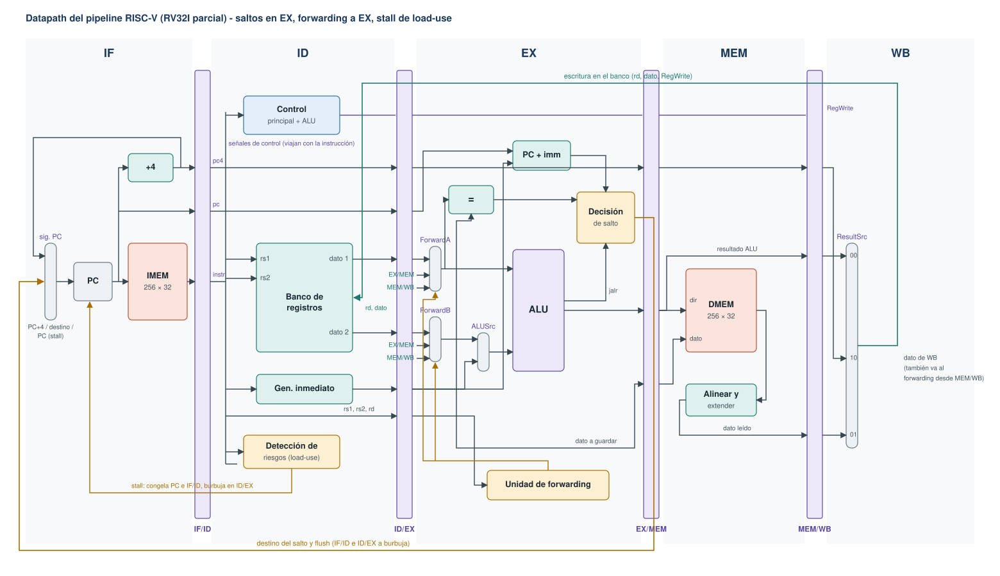

# Datapath del pipeline

Issue: #5



El SVG es editable con cualquier editor de gráficos vectoriales (Inkscape, por ejemplo). Las decisiones que dan forma a este diagrama están en [decisiones.md](decisiones.md) y el contenido exacto de cada latch en [latches.md](latches.md).

## Las etapas

| Etapa | Bloques | Qué hace |
|---|---|---|
| IF | Multiplexor de siguiente PC, PC, IMEM, sumador +4 | Busca la instrucción en `PC` y calcula `PC + 4` |
| ID | Control principal y de ALU, banco de registros, generador de inmediatos, detección de riesgos | Decodifica, lee rs1 y rs2, arma el inmediato y decide si hay que frenar |
| EX | Multiplexores de forwarding, multiplexor ALUSrc, ALU, comparador de igualdad, sumador PC+imm, decisión de salto, unidad de forwarding | Opera, calcula direcciones y resuelve todos los saltos |
| MEM | DMEM, alineación y extensión de loads | Lee o escribe la memoria de datos |
| WB | Multiplexor ResultSrc | Elige qué se escribe en rd: resultado de la ALU, dato leído o `PC + 4` |

Los dos caminos que vuelven hacia atrás son el destino de salto (de EX a IF, junto con el flush) y la escritura del banco (de WB a ID). El tercero, el forwarding, va de EX/MEM y MEM/WB a la entrada de EX.

## Siguiente PC

```
take    = idex_valid && (idex_jump || idex_jalr || (idex_branch && (eq ^ idex_funct3[0])))
target  = idex_jalr ? (alu_result & ~32'd1) : (idex_pc + idex_imm)

pc_next = take                        ? target
        : (stall || halt_pending)     ? pc
        :                               pc + 4
```

`eq` es la salida del comparador sobre los operandos ya adelantados. `funct3[0]` distingue `beq` (0) de `bne` (1). El PC se actualiza solo con `i_enable = 1`.

## Unidad de control principal

La decodificación completa se hace en ID y las señales viajan en ID/EX. El decodificador pone en 0 el número de rs1 o rs2 cuando la instrucción no usa ese registro; así ni la unidad de forwarding ni la de detección de riesgos ven dependencias falsas (por ejemplo con los bits del inmediato de un `addi` en la posición de rs2), y `lui` lee `x0 = 0` como primer operando sin un multiplexor extra.

| Tipo | opcode | reg_write | imm_sel | alu_src | alu_op | mem_read | mem_write | result_src | branch | jump | jalr | usa rs1 | usa rs2 |
|---|---|---|---|---|---|---|---|---|---|---|---|---|---|
| R | `0110011` | 1 | – | 0 | `10` | 0 | 0 | ALU | 0 | 0 | 0 | 1 | 1 |
| I aritméticas | `0010011` | 1 | I | 1 | `11` | 0 | 0 | ALU | 0 | 0 | 0 | 1 | 0 |
| Loads | `0000011` | 1 | I | 1 | `00` | 1 | 0 | MEM | 0 | 0 | 0 | 1 | 0 |
| Stores | `0100011` | 0 | S | 1 | `00` | 0 | 1 | – | 0 | 0 | 0 | 1 | 1 |
| Branches | `1100011` | 0 | B | – | – | 0 | 0 | – | 1 | 0 | 0 | 1 | 1 |
| `jal` | `1101111` | 1 | J | – | – | 0 | 0 | PC4 | 0 | 1 | 0 | 0 | 0 |
| `jalr` | `1100111` | 1 | I | 1 | `00` | 0 | 0 | PC4 | 0 | 0 | 1 | 1 | 0 |
| `lui` | `0110111` | 1 | U | 1 | `00` | 0 | 0 | ALU | 0 | 0 | 0 | 0 | 0 |
| HALT o ilegal | otro | 0 | – | – | – | 0 | 0 | – | 0 | 0 | 0 | 0 | 0 |

`–` significa que el valor no importa. Las señales que escriben estado (`reg_write`, `mem_write`) y las de salto nunca quedan indefinidas.

Codificaciones:

| Señal | Bits | Valores |
|---|---|---|
| `imm_sel` | 3 | `000` I, `001` S, `010` B, `011` U, `100` J |
| `result_src` | 2 | `00` ALU, `01` MEM, `10` PC4 |
| `alu_op` | 2 | `00` suma, `10` tipo R, `11` tipo I |

### Qué se considera ilegal (y por lo tanto HALT)

- Un opcode que no está en la tabla, incluido `0x00000000`.
- `ebreak` (`0x00100073`), que es el HALT intencional.
- Combinaciones no implementadas dentro de un opcode válido: loads con `funct3` `011`, `110` o `111`; stores con `funct3` mayor a `010`; branches que no sean `beq`/`bne` (`blt`, `bge`, `bltu`, `bgeu`); tipo R con `funct7` distinto de `0000000` y `0100000`, o con `0100000` fuera de `sub`/`sra`; `slli` y `srli`/`srai` con `funct7` inválido.

El volcado distingue HALT de instrucción ilegal (ver [latches.md](latches.md) y [protocolo.md](protocolo.md)).

## Control de la ALU

La operación de la ALU usa 4 bits elegidos para que la decodificación sea casi directa: el bit alto es el bit 30 de la instrucción y los tres bajos son `funct3`.

| `alu_ctrl` | Operación | Resultado |
|---|---|---|
| `0000` | ADD | `a + b` |
| `1000` | SUB | `a - b` |
| `0001` | SLL | `a << b[4:0]` |
| `0010` | SLT | `($signed(a) < $signed(b)) ? 1 : 0` |
| `0011` | SLTU | `(a < b) ? 1 : 0` |
| `0100` | XOR | `a ^ b` |
| `0101` | SRL | `a >> b[4:0]` |
| `1101` | SRA | `$signed(a) >>> b[4:0]` |
| `0110` | OR | `a \| b` |
| `0111` | AND | `a & b` |

```
alu_op = 00 -> alu_ctrl = 0000                                  (loads, stores, jalr, lui)
alu_op = 10 -> alu_ctrl = {instr[30], funct3}                   (tipo R)
alu_op = 11 -> alu_ctrl = (funct3 == 3'b101) ? {instr[30], funct3}
                                             : {1'b0, funct3}  (tipo I)
```

La diferencia entre tipo R y tipo I está en `funct3 = 000`: en `addi` el bit 30 es parte del inmediato y no puede convertir la suma en resta.

Respecto de la ALU del TP1 se agregan SLL, SLT y SLTU, NOR deja de hacer falta, y los códigos de 6 bits de la cátedra se reemplazan por este código interno. La máscara del desplazamiento (`b[4:0]`) es la misma idea de `$clog2(NB_DATA)` del TP1.

## Generador de inmediatos

```verilog
I : {{20{instr[31]}}, instr[31:20]}
S : {{20{instr[31]}}, instr[31:25], instr[11:7]}
B : {{19{instr[31]}}, instr[31], instr[7], instr[30:25], instr[11:8], 1'b0}
U : {instr[31:12], 12'b0}
J : {{11{instr[31]}}, instr[31], instr[19:12], instr[20], instr[30:21], 1'b0}
```

## Forwarding y detección de riesgos

Las condiciones exactas están en [decisiones.md, D6](decisiones.md#d6-forwarding-hacia-ex-stall-de-load-use-y-bypass-del-banco). Resumen de los valores que circulan:

| Fuente | Valor adelantado |
|---|---|
| EX/MEM | `exmem_pc4` si `result_src = PC4`, si no `exmem_alu_result` |
| MEM/WB | La salida del multiplexor de WB (lo que se escribe en rd) |

La salida del multiplexor ForwardB alimenta tres cosas: el multiplexor ALUSrc, el comparador de igualdad y el dato que se guarda en un store.

## Módulos

| Módulo | Etapa | Responsabilidad |
|---|---|---|
| `cpu` | – | Tope del procesador: instancia las etapas y expone los puertos para la Debug Unit |
| `imem` | IF | Memoria de instrucciones (escritura desde la Debug Unit, lectura asíncrona) |
| `decoder` | ID | Control principal: opcode a señales de control, detección de ilegal/HALT |
| `alu_control` | ID | `alu_op`, `funct3` y bit 30 a `alu_ctrl` |
| `imm_gen` | ID | Inmediato de 32 bits según `imm_sel` |
| `register_file` | ID/WB | 32 × 32, x0 fijo en 0, bypass, puerto extra para la Debug Unit |
| `hazard_unit` | ID | Stall de load-use |
| `forwarding_unit` | EX | ForwardA y ForwardB |
| `alu` | EX | Las 10 operaciones |
| `branch_unit` | EX | Comparador, sumador de destino y decisión de salto |
| `dmem` | MEM | Memoria de datos en 4 bancos de bytes, puerto extra para la Debug Unit |
| `load_store_unit` | MEM | Máscara de escritura y alineación/extensión de loads |

Los latches se implementan directamente en `cpu` (o en un módulo `pipeline_regs`) con los nombres de campo de [latches.md](latches.md).
