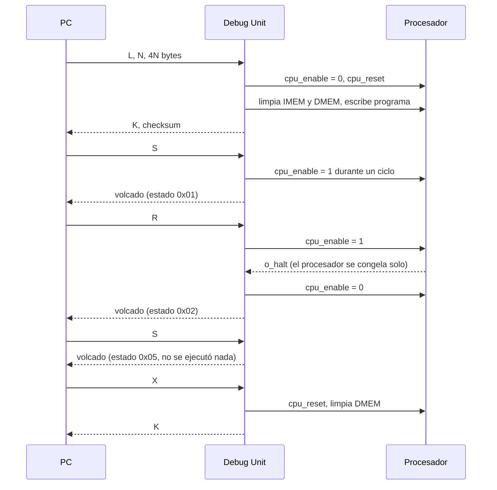
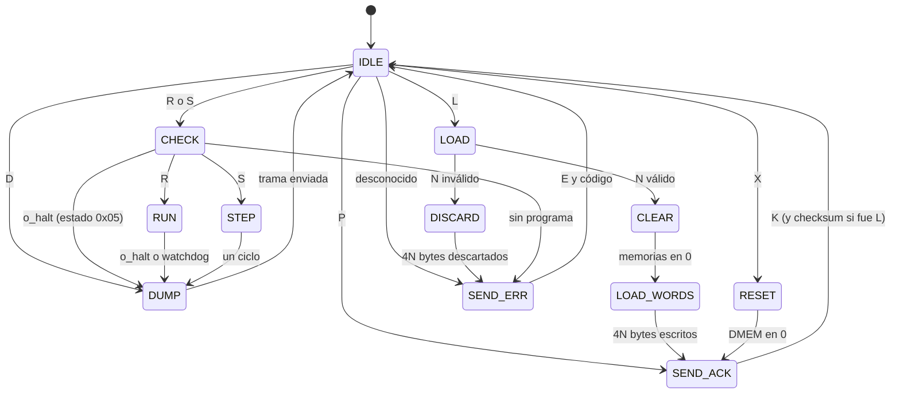

# Protocolo UART de la Debug Unit

Issue: #9

Contrato entre la Debug Unit (Verilog), el ensamblador y la interfaz de PC. Cualquier cambio acá se aplica en los dos lados a la vez.

## Capa física

| Parámetro | Valor |
|---|---|
| Formato | 8N1: 1 bit de start, 8 de datos (LSB primero), sin paridad, 1 de stop |
| Velocidad | 115 200 baudios |
| Divisor a 100 MHz | `M = 100 000 000 / (115 200 × 16) = 54` → 115 741 baudios reales, error +0,47 % |
| Orden de bytes | Little-endian en todo número de más de un byte |

Se sube de 19 200 (TP2) a 115 200 baudios para que el volcado en paso a paso tarde decenas de milisegundos en vez de cientos. Si en M7 cambia la frecuencia del reloj, hay que recalcular `M` y verificar que el error siga por debajo del 2 % (ver la tabla de errores en la guía de estudio, parte 8).

| Velocidad | `M` | Baudios reales | Error |
|---|---|---|---|
| 19 200 (TP2) | 326 | 19 172 | −0,15 % |
| 115 200 | 54 | 115 741 | +0,47 % |
| 230 400 | 27 | 231 481 | +0,47 % |

Se quedó en 115 200 y no en 230 400 porque es la velocidad estándar más alta que cualquier terminal serie y `pyserial` manejan sin configuración especial, y el volcado ya tarda menos de lo que se nota al apretar una tecla.

La UART y la interfaz buffer + flag son las del TP2. La Debug Unit lee con `rd` cuando `rx_empty = 0` y escribe con `wr` cuando `tx_full = 0`.

**Restricción del buffer de recepción.** La interfaz del TP2 guarda un solo byte: si llega otro antes de que la Debug Unit lo lea, el anterior se pierde. Un byte tarda 10 bits / 115 200 ≈ 87 µs, unos 8700 ciclos a 100 MHz, así que la Debug Unit tiene que leer cada byte dentro de ese tiempo. Eso se cumple en todos los estados que reciben datos, incluida la carga: la limpieza de las memorias (256 ciclos) termina mucho antes de que llegue la primera palabra del programa.

## Reglas de la comunicación

- **Pedido y respuesta.** La PC manda un comando completo y espera la respuesta completa antes de mandar el siguiente. La Debug Unit nunca manda nada por su cuenta.
- **Sin comandos durante la ejecución.** Mientras la Debug Unit está en RUN o mandando un volcado no lee la UART; un byte que llegue en ese momento queda en el buffer (o pisa al anterior) y se interpreta como comando al volver a IDLE. Por eso la regla anterior es obligatoria.
- **Timeout en la PC.** Si la respuesta no llega completa en 2 s, la PC la descarta. Alcanza con margen para el caso más largo: un `R` que termina por watchdog (unos 10 ms) seguido del volcado con la DMEM entera (unos 107 ms).
- **Resincronización.** Si la PC pierde la cuenta de los bytes (por un timeout o un checksum malo), vacía su buffer de entrada, espera 200 ms (más que el volcado más largo) y manda `P` hasta recibir `K`. Como todos los comandos sin argumentos son de un byte y cualquier byte desconocido responde un error de 2 bytes, la Debug Unit siempre termina en IDLE. El único estado del que no sale sola es una carga cortada a la mitad (ver [Errores](#errores)).

## Comandos

Cada mensaje de la PC empieza con un byte de comando. Son letras ASCII para que el tráfico se pueda leer con un terminal serie.

| Comando | Byte | Bytes que siguen | Qué hace la Debug Unit | Respuesta |
|---|---|---|---|---|
| Ping | `P` (`0x50`) | – | Nada | `K` |
| Cargar | `L` (`0x4C`) | N (2 bytes), 4N bytes de programa | Detiene, resetea el procesador, limpia IMEM y DMEM, escribe N palabras desde la dirección 0 | `K` + checksum, o error |
| Correr | `R` (`0x52`) | – | `cpu_enable = 1` hasta HALT, instrucción ilegal o watchdog | Volcado, o error |
| Paso | `S` (`0x53`) | – | `cpu_enable = 1` durante un ciclo | Volcado, o error |
| Volcado | `D` (`0x44`) | – | Nada, solo lee el estado | Volcado |
| Reiniciar | `X` (`0x58`) | – | Detiene, resetea el procesador y limpia la DMEM. La IMEM no se toca | `K` |

Los comandos de la consigna corresponden a: cargar programa → `L`, run → `R`, step → `S`, reset → `X`, leer estado → `D`. `P` sirve para comprobar la conexión y resincronizar.

Respuestas posibles de cada comando:

| Comando | Respuesta | Largo |
|---|---|---|
| `P` | `4B` | 1 |
| `L` | `4B`, checksum del programa | 2 |
| `L` con `N` inválido | `45 02` | 2 |
| `R`, `S` | Volcado con estado `0x01` a `0x05` | 207 + 4K |
| `R`, `S` sin programa cargado | `45 03` | 2 |
| `D` | Volcado con estado `0x00` | 207 + 4K |
| `X` | `4B` | 1 |
| Otro byte | `45 01` | 2 |

La PC distingue el tipo de respuesta por el primer byte: `4B` (OK), `45` (error) o `A5` (volcado). Por eso ninguno de los tres puede aparecer como primer byte de otra respuesta.

### Detalle de Cargar

```
4C  N[7:0]  N[15:8]  w0[7:0] w0[15:8] w0[23:16] w0[31:24]  w1[7:0] ...  w(N-1)[31:24]
```

- `N` es la cantidad de palabras de 32 bits, entre 1 y 256.
- Cada palabra va en little-endian, la palabra 0 primero. La palabra `i` se escribe en la dirección `4·i`.
- La Debug Unit arma cada palabra con un contador de bytes (0 a 3) y la escribe en la IMEM al recibir el cuarto byte.
- Mientras recibe, calcula el XOR de los 4N bytes del programa y lo manda después del `K`. La PC lo compara con el suyo: si no coincide, un byte se corrompió en el camino y la carga se repite. Es la misma verificación que el checksum del volcado, pero en el otro sentido, y cuesta un registro de 8 bits.
- Si `N` es 0 o mayor que 256, la Debug Unit **igual recibe y descarta los 4N bytes** que siguen, sin tocar las memorias, y recién ahí responde el error `0x02`. Si respondiera apenas recibe `N`, los bytes del programa que la PC ya está mandando se interpretarían como comandos (un `0x52` en medio del código haría un `R`). Con `N = 0` no hay bytes que descartar. La interfaz valida `N` antes de mandar, así que en uso normal esto no pasa.
- Un `N` inválido no cambia nada: no hay reset del procesador ni limpieza, y el programa anterior sigue cargado.

Ejemplo: `addi x1, x0, 5` (`0x00500093`) seguido de HALT (`0x00100073`):

```
PC -> FPGA:  4C 02 00  93 00 50 00  73 00 10 00
FPGA -> PC:  4B A0
```

El checksum es `93 ^ 00 ^ 50 ^ 00 ^ 73 ^ 00 ^ 10 ^ 00 = 0xA0`.

Duración: `3 + 4N` bytes, o sea 0,35 ms por palabra; un programa de 256 palabras tarda unos 89 ms.

## Respuestas cortas

| Respuesta | Bytes | Significado |
|---|---|---|
| OK | `4B` (`K`) | Comando aceptado y terminado (en Cargar, seguido del checksum) |
| Error | `45` (`E`), código | El comando no se ejecutó y el estado no cambió |

## Errores

| Código | Error | Qué hace la Debug Unit | Qué hace la PC |
|---|---|---|---|
| `0x01` | Comando desconocido | Responde y vuelve a IDLE; el byte se descarta | Avisa; si no lo esperaba, resincroniza con `P` |
| `0x02` | `N` fuera de rango en Cargar | Descarta los 4N bytes, responde y vuelve a IDLE | No debería pasar: la interfaz valida `N` antes |
| `0x03` | Correr o Paso sin ningún programa cargado desde que se encendió la placa o se presionó el reset | Responde sin habilitar el procesador | Pide cargar un programa |

Situaciones que no generan un código de error:

| Situación | Cómo se detecta | Qué pasa |
|---|---|---|
| Correr o Paso con el programa terminado | Estado `0x05` en el volcado | No se ejecuta nada; la PC puede mandar `X` para volver a empezar |
| Programa sin HALT o en bucle infinito | Estado `0x03` (memoria vacía) o `0x04` (watchdog) | Ver [D10](decisiones.md#d10-qué-pasa-si-la-memoria-no-tiene-instrucción-de-parada) |
| Byte corrompido de la PC a la FPGA en una carga | El checksum de la respuesta a `L` no coincide | La PC repite la carga |
| Byte corrompido de la FPGA a la PC | Marca distinta de `A5`, checksum malo o timeout | La PC descarta la respuesta, resincroniza y repite el comando (`D` si fue un volcado, que no cambia el estado) |
| Carga cortada a la mitad | La PC no recibe `K` antes del timeout | La Debug Unit queda esperando bytes; hay que apretar BTNU (ver abajo) |
| Byte corrompido en el bit de start o de stop | La UART del TP2 no detecta errores de trama | Se ve como un byte de más o de menos; termina en uno de los casos anteriores |

Repetir `R` o `S` después de un error de transmisión no es seguro, porque el comando pudo haberse ejecutado. Por eso la PC, ante una respuesta perdida, pide un `D` para saber en qué estado quedó el procesador.

## Volcado de estado

Respuesta de Correr, Paso y Volcado. Todos los campos de varios bytes van en little-endian. La Debug Unit lo arma con el procesador detenido, así que todos los campos son del mismo ciclo.

| Offset | Bytes | Campo | Contenido |
|---|---|---|---|
| 0 | 1 | Marca | `0xA5` |
| 1 | 1 | Estado | Ver tabla de estados |
| 2 | 4 | Ciclos | Flancos en que el procesador avanzó (`cpu_enable && !o_halt`) desde el último reset del procesador |
| 6 | 4 | PC | Valor del registro PC |
| 10 | 128 | Registros | x0 a x31, 4 bytes cada uno, x0 primero |
| 138 | 13 | IF/ID | Vector de [latches.md](latches.md), byte bajo primero |
| 151 | 25 | ID/EX | Ídem |
| 176 | 14 | EX/MEM | Ídem |
| 190 | 14 | MEM/WB | Ídem |
| 204 | 2 | K | Cantidad de palabras de DMEM que se envían |
| 206 | 4K | DMEM | Palabras 0 a K-1, la palabra 0 primero |
| 206 + 4K | 1 | Checksum | XOR de todos los bytes anteriores, desde la marca |

Largo total: `207 + 4K` bytes. Con K = 0 son 207 bytes (unos 18 ms); con la memoria entera (K = 256), 1231 bytes (unos 107 ms).

### Registros

32 registros × 4 bytes = 128 bytes, en orden x0, x1, …, x31, cada uno little-endian. x0 se manda aunque siempre valga 0, así el registro `i` está siempre en el offset `10 + 4i` y la interfaz no necesita un caso especial. La Debug Unit los lee uno por uno por el puerto extra del banco (`i_dbg_reg_addr`, `o_dbg_reg_data`), con un contador de 5 bits para el registro y otro de 2 bits para el byte.

### Latches

Se mandan en el orden del pipeline: IF/ID, ID/EX, EX/MEM, MEM/WB. Cada uno es el vector de [latches.md](latches.md) rellenado con ceros hasta un número entero de bytes, byte menos significativo primero (bits `[7:0]` primero):

| Latch | Bits | Bytes | Relleno |
|---|---|---|---|
| IF/ID | 97 | 13 | 7 |
| ID/EX | 194 | 25 | 6 |
| EX/MEM | 112 | 14 | 0 |
| MEM/WB | 107 | 14 | 5 |
| Total | 510 | 66 | |

Si cambia un campo en [latches.md](latches.md), cambian los offsets desde ese latch en adelante; hay que actualizar esta tabla, la de arriba y el decodificador de la interfaz a la vez.

La interfaz puede saber si el programa terminó mirando el propio volcado, sin depender del estado: con el procesador detenido por HALT, `memwb_valid = 1` y `memwb_halt = 1`. Así un `D` también muestra si el programa ya terminó.

### Estados

| Código | Estado | Cuándo |
|---|---|---|
| `0x00` | Detenido | Respuesta a Volcado sin haber ejecutado nada en este comando |
| `0x01` | Paso | Se ejecutó un ciclo y el programa no terminó |
| `0x02` | HALT | El programa terminó con `ebreak` |
| `0x03` | Ilegal | El programa terminó por una instrucción no reconocida (incluye llegar a memoria vacía, `0x00000000`) |
| `0x04` | Watchdog | En modo continuo se superaron `WATCHDOG_CYCLES` ciclos sin terminar |
| `0x05` | Ya terminado | Llegó Correr o Paso con el programa ya terminado; no se ejecutó nada |

Para distinguir HALT de ilegal, la Debug Unit mira `o_halt_illegal` (el bit `memwb_illegal`) cuando `o_halt` se activa. Como el procesador se congela solo con `o_halt` ([D7](decisiones.md#d7-clock-enable-global)), los dos bits se mantienen hasta el próximo reset y la Debug Unit puede leerlos en cualquier momento.

### Memoria de datos usada

`K` es uno más que el índice de palabra más alto escrito por un store desde el último reset del procesador (0 si no hubo stores). La Debug Unit lo calcula mirando las escrituras de la DMEM. Como la carga limpia la memoria, las palabras por debajo de `K` que el programa no escribió valen 0.

Se eligió así porque manda solo lo que el programa tocó, sin que haya que configurar un rango, y el largo de la trama queda determinado por `K` antes de enviar los datos.

| Opción | A favor | En contra |
|---|---|---|
| Siempre las 256 palabras | Trivial | 1231 bytes en cada paso, unos 107 ms, aunque el programa no use memoria |
| Solo las palabras escritas, con su dirección | Lo mínimo posible | Hace falta guardar qué palabras se escribieron (un bit por palabra) y la trama crece 2 bytes por palabra |
| Desde 0 hasta la más alta escrita (elegida) | Un comparador y un registro de 8 bits; la interfaz recibe un arreglo contiguo | Si el programa escribe solo en la última palabra, se manda la memoria entera |

Detalle del cálculo: cada vez que `o_dmem_write = 1` (un store que realmente se ejecuta, D7), si `o_dmem_waddr + 1 > K` entonces `K = o_dmem_waddr + 1`. `sb` y `sh` cuentan como escritura de su palabra. Las escrituras de la Debug Unit al limpiar no cuentan. `K` es de 9 bits porque llega a 256, y viaja en 2 bytes.

Las palabras se leen por el puerto de la Debug Unit (`i_dbg_dmem_addr`, `o_dbg_dmem_rdata`) y van en little-endian, igual que en la memoria: el byte en la dirección `4i` sale primero.

### Validación en la PC

La interfaz descarta la trama y avisa si:

- el primer byte no es `0xA5`,
- no llegan todos los bytes antes de un timeout (2 s es razonable),
- el checksum no coincide.

## Secuencias típicas



## Máquina de estados de la Debug Unit



Cada estado grande se descompone en subestados que esperan `rx_empty = 0` o `tx_full = 0`, con el mismo handshake combinacional del `top_uart_alu` del TP2.

No hay timeout dentro de LOAD ni de DISCARD: si la PC corta la transmisión a mitad de un programa, la Debug Unit queda esperando bytes. El botón de reset (BTNU) la devuelve a IDLE. Un timeout en hardware (por ejemplo, volver a IDLE si pasan 100 ms sin bytes) es una mejora posible, pero la PC siempre manda la carga completa de una vez, así que el caso solo aparece si se desconecta el cable.
