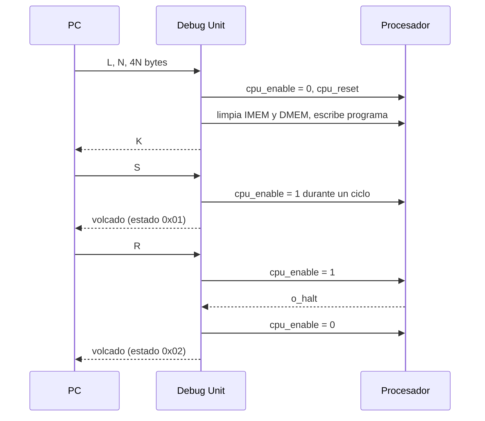
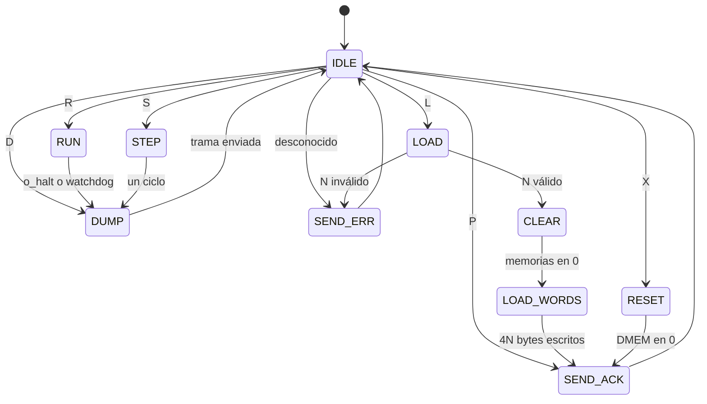

# Protocolo UART de la Debug Unit

Issue: #9

Contrato entre la Debug Unit (Verilog), el ensamblador y la interfaz de PC. Cualquier cambio acá se aplica en los dos lados a la vez.

## Capa física

| Parámetro | Valor |
|---|---|
| Formato | 8N1: 1 bit de start, 8 de datos (LSB primero), sin paridad, 1 de stop |
| Velocidad | 115 200 baudios |
| Divisor a 100 MHz | `M = 100 000 000 / (115 200 × 16) = 54` → 115 741 baudios reales, error +0,47 % |
| Orden de bytes | Little-endian en todo número de más de un byte |

Se sube de 19 200 (TP2) a 115 200 baudios para que el volcado en paso a paso tarde decenas de milisegundos en vez de cientos. Si en M7 cambia la frecuencia del reloj, hay que recalcular `M` y verificar que el error siga por debajo del 2 % (ver la tabla de errores en la guía de estudio, parte 8).

La UART y la interfaz buffer + flag son las del TP2. La Debug Unit lee con `rd` cuando `rx_empty = 0` y escribe con `wr` cuando `tx_full = 0`.

## Comandos

Cada mensaje de la PC empieza con un byte de comando. Son letras ASCII para que el tráfico se pueda leer con un terminal serie.

| Comando | Byte | Bytes que siguen | Qué hace la Debug Unit | Respuesta |
|---|---|---|---|---|
| Ping | `P` (`0x50`) | – | Nada | `K` |
| Cargar | `L` (`0x4C`) | N (2 bytes), 4N bytes de programa | Detiene, resetea el procesador, limpia IMEM y DMEM, escribe N palabras desde la dirección 0 | `K` o error |
| Correr | `R` (`0x52`) | – | `cpu_enable = 1` hasta HALT, instrucción ilegal o watchdog | Volcado |
| Paso | `S` (`0x53`) | – | `cpu_enable = 1` durante un ciclo | Volcado |
| Volcado | `D` (`0x44`) | – | Nada, solo lee el estado | Volcado |
| Reiniciar | `X` (`0x58`) | – | Detiene, resetea el procesador y limpia la DMEM. La IMEM no se toca | `K` |

### Detalle de Cargar

```
4C  N[7:0]  N[15:8]  w0[7:0] w0[15:8] w0[23:16] w0[31:24]  w1[7:0] ...  w(N-1)[31:24]
```

- `N` es la cantidad de palabras de 32 bits, entre 1 y 256.
- Cada palabra va en little-endian, la palabra 0 primero. La palabra `i` se escribe en la dirección `4·i`.
- La Debug Unit arma cada palabra con un contador de bytes (0 a 3) y la escribe en la IMEM al recibir el cuarto byte.
- Si `N` es 0 o mayor que 256, responde el error `0x02` apenas termina de recibir `N` y vuelve a esperar un comando. La interfaz valida `N` antes de mandar, así que en uso normal esto no pasa.

Ejemplo: `addi x1, x0, 5` (`0x00500093`) seguido de HALT (`0x00100073`):

```
PC -> FPGA:  4C 02 00  93 00 50 00  73 00 10 00
FPGA -> PC:  4B
```

## Respuestas cortas

| Respuesta | Bytes | Significado |
|---|---|---|
| OK | `4B` (`K`) | Comando aceptado y terminado |
| Error | `45` (`E`), código | El comando no se ejecutó |

| Código | Error |
|---|---|
| `0x01` | Comando desconocido |
| `0x02` | `N` fuera de rango en Cargar |
| `0x03` | Correr o Paso sin ningún programa cargado desde que se encendió la placa o se presionó el reset |

## Volcado de estado

Respuesta de Correr, Paso y Volcado. Todos los campos de varios bytes van en little-endian.

| Offset | Bytes | Campo | Contenido |
|---|---|---|---|
| 0 | 1 | Marca | `0xA5` |
| 1 | 1 | Estado | Ver tabla de estados |
| 2 | 4 | Ciclos | Ciclos con `cpu_enable = 1` desde el último reset del procesador |
| 6 | 4 | PC | Valor del registro PC |
| 10 | 128 | Registros | x0 a x31, 4 bytes cada uno, x0 primero |
| 138 | 13 | IF/ID | Vector de [latches.md](latches.md), byte bajo primero |
| 151 | 25 | ID/EX | Ídem |
| 176 | 14 | EX/MEM | Ídem |
| 190 | 14 | MEM/WB | Ídem |
| 204 | 2 | K | Cantidad de palabras de DMEM que se envían |
| 206 | 4K | DMEM | Palabras 0 a K-1, la palabra 0 primero |
| 206 + 4K | 1 | Checksum | XOR de todos los bytes anteriores, desde la marca |

Largo total: `207 + 4K` bytes. Con K = 0 son 207 bytes (unos 18 ms); con la memoria entera (K = 256), 1231 bytes (unos 107 ms).

### Estados

| Código | Estado | Cuándo |
|---|---|---|
| `0x00` | Detenido | Respuesta a Volcado sin haber ejecutado nada en este comando |
| `0x01` | Paso | Se ejecutó un ciclo y el programa no terminó |
| `0x02` | HALT | El programa terminó con `ebreak` |
| `0x03` | Ilegal | El programa terminó por una instrucción no reconocida (incluye llegar a memoria vacía, `0x00000000`) |
| `0x04` | Watchdog | En modo continuo se superaron `WATCHDOG_CYCLES` ciclos sin terminar |
| `0x05` | Ya terminado | Llegó Correr o Paso con el programa ya terminado; no se ejecutó nada |

Para distinguir HALT de ilegal, la Debug Unit mira el bit `memwb_illegal` cuando `o_halt` se activa.

### Memoria de datos usada

`K` es uno más que el índice de palabra más alto escrito por un store desde el último reset del procesador (0 si no hubo stores). La Debug Unit lo calcula mirando las escrituras de la DMEM. Como la carga limpia la memoria, las palabras por debajo de `K` que el programa no escribió valen 0.

Se eligió así porque manda solo lo que el programa tocó, sin que haya que configurar un rango, y el largo de la trama queda determinado por `K` antes de enviar los datos.

### Validación en la PC

La interfaz descarta la trama y avisa si:

- el primer byte no es `0xA5`,
- no llegan todos los bytes antes de un timeout (2 s es razonable),
- el checksum no coincide.

## Secuencias típicas



## Máquina de estados de la Debug Unit



Cada estado grande se descompone en subestados que esperan `rx_empty = 0` o `tx_full = 0`, con el mismo handshake combinacional del `top_uart_alu` del TP2.

No hay timeout dentro de LOAD: si la PC corta la transmisión a mitad de un programa, la Debug Unit queda esperando bytes. El botón de reset (BTNU) la devuelve a IDLE.
