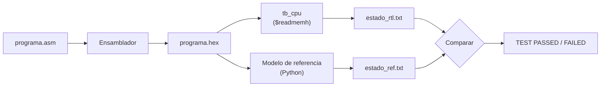

# Estrategia de verificación

Issue: #10

Cómo se prueba cada parte antes de pasar a la siguiente. La idea es la misma que en el TP1 y el TP2: test benches que se verifican solos y terminan diciendo `TEST PASSED` o `TEST FAILED`, sin depender de mirar formas de onda.

## Niveles

| Nivel | Milestone | Qué se prueba | Contra qué se compara |
|---|---|---|---|
| Módulo | M1 | Cada bloque por separado | Valor esperado calculado en el test bench |
| Procesador | M2, M3 | `cpu` ejecutando programas | Modelo de referencia en Python |
| Debug Unit | M5 | `top` completo a través de la línea serie | Volcados esperados |
| Placa | M7 | El sistema real con la interfaz | Modelo de referencia y simulación |

## Nivel 1: test benches de módulo

Mismo esquema que `tb_alu` del TP1: una `task` aplica las entradas, calcula el valor esperado y compara con `!==` (que también detecta `x`). Primero casos dirigidos a los bordes y después muchos casos aleatorios con `$random`.

| Módulo | Casos dirigidos | Aleatorio |
|---|---|---|
| `alu` | Desbordes, comparación con signo y sin signo con el bit 31 en 1, desplazamientos por 0 y por 31 | 100 iteraciones de las 10 operaciones |
| `register_file` | x0 siempre 0 aunque se escriba, escritura y lectura del mismo registro en el mismo ciclo (bypass), `enable = 0` no escribe | Escrituras y lecturas aleatorias contra un arreglo de referencia |
| `imm_gen` | Los 5 formatos con inmediato positivo, negativo y extremo; los ejemplos de la guía (`0xFE009CE3` → −8, `0x010000EF` → +16) | Instrucciones aleatorias contra una función de referencia escrita en el test bench |
| `decoder`, `alu_control` | Una instrucción de cada una de las 32, más ilegales (`0x00000000`, `blt`, `funct7` inválido) y `ebreak` | – |
| `load_store_unit`, `dmem` | Todos los tamaños en las 4 posiciones de byte, extensión de signo con el bit alto en 1 y en 0 | Secuencias de stores y loads contra un arreglo de bytes |
| `forwarding_unit`, `hazard_unit` | Cada fila de la tabla de casos de [D6](decisiones.md#d6-forwarding-hacia-ex-stall-de-load-use-y-bypass-del-banco), incluido x0 y `valid = 0` | – |
| `branch_unit` | beq y bne tomados y no tomados, jal, jalr con bit 0 en 1 | – |

Las entradas se cambian en el flanco negativo y las salidas se leen un poco después del flanco positivo (`#1`), como en el TP1 y el TP2.

## Nivel 2: el procesador con programas

### Flujo



1. `tb_cpu` carga el `.hex` en la IMEM con `$readmemh`, aplica reset, deja `i_enable = 1` y espera `o_halt` (con un límite de ciclos para no colgarse si el programa no termina).
2. Al terminar escribe en un archivo los 32 registros, las palabras de la DMEM, el PC y la cantidad de ciclos.
3. El modelo de referencia ejecuta el mismo `.hex` instrucción por instrucción (sin pipeline) y escribe el estado final en el mismo formato.
4. Un script compara los dos archivos y además verifica los ciclos esperados cuando el programa los indica.

El modelo de referencia no sabe nada del pipeline: si el procesador da un estado distinto, el error es del procesador (o de un riesgo mal resuelto). Esto es lo que encuentra los bugs de forwarding que no se ven mirando un módulo solo.

### Formato del estado final

Texto, una línea por dato, para poder compararlo con `diff`:

```
pc 00000018
x00 00000000
x01 00000005
...
x31 00000000
mem 000 00000006
mem 001 00000000
...
cycles 20
```

### Modelo de referencia

Script de Python en `sw/modelo/` que:

- implementa las 32 instrucciones y el HALT con la misma semántica que [datapath.md](datapath.md) (incluido qué es ilegal),
- marca como error los accesos desalineados (ver [D3](decisiones.md#d3-accesos-de-distinto-tamaño-y-desalineados)) y la escritura fuera de los 1 KiB,
- se detiene en HALT o después de un límite de instrucciones.

También sirve para la interfaz: puede mostrar al lado del volcado real qué valores debería tener cada registro.

### Programas de prueba

En `sw/programas/`. Cada programa empieza con un comentario que dice qué prueba y, si corresponde, cuántos ciclos debe tardar.

| Programa | Prueba |
|---|---|
| `alu_r.asm`, `alu_i.asm` | Todas las operaciones tipo R e I, con NOPs entre dependencias (M2) |
| `memoria.asm` | `lb`, `lh`, `lw`, `lbu`, `lhu`, `sb`, `sh`, `sw` en todas las posiciones de byte, con signo |
| `lui.asm` | `lui` + `addi` para cargar constantes de 32 bits, incluido el caso con la parte baja ≥ `0x800` |
| `saltos.asm` | beq y bne tomados y no tomados, jal y jalr (llamada y retorno) |
| `x0.asm` | Escribir x0 con distintas instrucciones y leerlo después |
| `fwd_*.asm` | Un programa por fila de la tabla de casos de D6 |
| `load_use.asm` | lw seguido de uso, y lw seguido de sw del mismo registro |
| `halt_especulativo.asm` | HALT inmediatamente después de un salto tomado |
| `sin_halt.asm` | Programa sin HALT: debe terminar con estado "ilegal" al llegar a memoria vacía |
| `bucle_infinito.asm` | `j .` (salto a sí mismo): debe cortar por watchdog en la Debug Unit |
| `suma.asm`, `bucle.asm` | Los ejemplos de la guía y del simulador |

Los programas de M2 llevan NOPs suficientes para no tener riesgos. En M3 se escriben versiones sin NOPs que tienen que dar el mismo estado final, y además se controlan los ciclos.

### Ciclos esperados

Con las decisiones de este diseño (forwarding, saltos en EX) los ejemplos del simulador de la guía dan:

| Programa | Ciclo en que el HALT llega a WB | Contador de la Debug Unit |
|---|---|---|
| Cadena de dependencias | 10 | 9 |
| Load-use y store | 11 | 10 |
| Bucle con salto tomado | 21 | 20 |
| Bucle reordenado | 21 | 20 |
| Sin dependencias | 10 | 9 |

El contador de la Debug Unit cuenta flancos con `cpu_enable = 1`. `o_halt` se activa después del flanco en que el HALT entra a MEM/WB, así que el contador queda uno por debajo del número de ciclo en que el HALT está en WB. Para que esto se cumpla, `cpu_enable` tiene que bajar en el mismo ciclo en que la Debug Unit ve `o_halt` (salida combinacional de la FSM, como `rd` y `wr` en el TP2); si bajara un ciclo tarde, el HALT saldría de MEM/WB con un flanco de más.

### Programas aleatorios

Como el `$random` del TP1, pero a nivel de programa: un script genera secuencias aleatorias de instrucciones aritméticas, loads y stores (sin saltos, con direcciones alineadas dentro de la DMEM) y registros elegidos de un conjunto chico para forzar dependencias a distancia 1, 2 y 3. Cada secuencia se corre en `tb_cpu` y en el modelo, y se comparan los estados. Es la forma más rápida de encontrar combinaciones de forwarding que nadie pensó a mano.

## Nivel 3: la Debug Unit

`tb_top` prueba el sistema completo solo a través de `i_rx` y `o_tx`, como `tb_top_level` del TP2: tasks `send_byte` y `recv_byte`, y un baud rate alto para acortar la simulación.

| Escenario | Qué se verifica |
|---|---|
| Ping | Responde `K` |
| Cargar | Responde `K`; la IMEM tiene las palabras en orden; la DMEM y los registros quedan en 0 |
| Cargar con N inválido | Responde `E 0x02` y sigue aceptando comandos |
| Comando desconocido | Responde `E 0x01` |
| Paso | Un volcado por comando; el contador de ciclos sube de a 1; los latches avanzan una etapa |
| Correr | Volcado con estado HALT y el estado final igual al del modelo de referencia |
| Correr después de terminar | Estado `0x05` y nada cambia |
| Reiniciar | PC en 0, pipeline vacío, registros y DMEM en 0, IMEM intacta |
| Programa sin HALT | Estado `0x03` (ilegal) |
| Bucle infinito | Estado `0x04` (watchdog), con `WATCHDOG_CYCLES` reducido para la simulación |
| Checksum | El último byte coincide con el XOR de los anteriores |

## Nivel 4: placa

En M7 se repiten los programas de prueba en la Basys3 con la interfaz, comparando el volcado contra el modelo de referencia, y se prueba la reprogramación: cargar varios programas seguidos sin volver a programar la FPGA.

## Herramientas

- Vivado (xsim) para los test benches, como en los TP anteriores.
- Para correr muchos programas seguidos conviene un script en `scripts/` que lance la simulación en modo batch (`xvlog`, `xelab`, `xsim -R`) o con Icarus Verilog, y después el comparador en Python.
